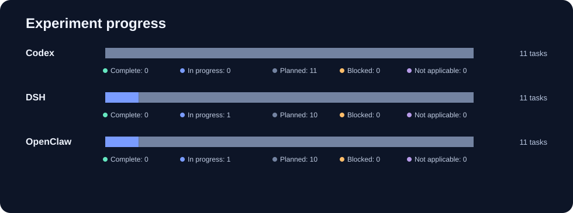

# Agent Platform and Harness Architecture Evaluation

Architecture research for **Codex, DeepSeek Harness (DSH), and OpenClaw**, across two complementary layers: how a system hosts agent work, and how its harness manages each execution. Six dimensions—reliability, security, performance, cost, extensibility, and observability—apply to both layers.

## Live CI

[](https://github.com/zyw02/openclaw-hermes-architecture-evaluation/actions/workflows/comparison-calibration.yml?query=branch%3Aresearch%2Fcomparison-calibration)

[](https://github.com/zyw02/openclaw-hermes-architecture-evaluation/actions/workflows/comparison-calibration.yml?query=branch%3Aresearch%2Fcomparison-calibration)

[View live comparison runs, individual jobs, logs, and artifacts](https://github.com/zyw02/openclaw-hermes-architecture-evaluation/actions/workflows/comparison-calibration.yml?query=branch%3Aresearch%2Fcomparison-calibration). GitHub supplies the badge and run page; the badge reflects the latest workflow outcome, while the run page shows jobs currently in progress. The table below tracks research work, updated from the repository ledger; it does not automatically reflect a running job.

<!-- comparison-dashboard:start -->
## Research progress

Each cell is a work item, not a success rate. Historical OpenClaw evidence is not counted as completed cross-product work.

| Layer / experiment | Codex | DSH | OpenClaw |
| --- | --- | --- | --- |
| Platform · P01 Fault domains | Planned | Planned | Planned |
| Platform · P02 State and deployment | Planned | Planned | Planned |
| Platform · P03 Resources and concurrency | Planned | Planned | Planned |
| Platform · P04 Access and operations | Planned | Planned | Planned |
| Harness · H03 Compaction and constraints | Planned | Planned | Planned |
| Harness · H04 Large tool outputs | Planned | Planned | Planned |
| Harness · H05 Recovery and side effects | Planned | In progress | In progress |
| Harness · H07 Model failure and retry | Planned | Planned | Planned |
| Harness · H08 Tool scheduling | Planned | Planned | Planned |
| Harness · H11 Approval binding | Planned | Planned | Planned |
| Harness · H17 Execution trace | Planned | Planned | Planned |

**Latest session calibration:** success (aggregate of three independent runners). [View run and individual jobs](https://github.com/zyw02/openclaw-hermes-architecture-evaluation/actions/runs/40622793927).

**Frozen OpenClaw campaign:** 253/257 scenarios measured; 224 passed, 29 retained failures, 4 confirmed not applicable; 969 independent observations. [Audit and evidence](evaluation/campaigns/full-20261026-batched/README.md).

Generated from the [progress ledger](comparison/progress.json) and the frozen audit. GitHub Actions shows live job steps; session calibration results synchronize automatically. See [maintenance](comparison/README.md).
<!-- comparison-dashboard:end -->

## What the experiments reveal

| Experiment group | Architecture question | What the evidence can show |
| --- | --- | --- |
| Platform · fault domains | Who owns a task if its caller or service stops? | Process boundaries, surviving work, and recovery responsibility. |
| Platform · state and deployment | Where do sessions, credentials, and workspaces live? | What survives a restart and what depends on external components. |
| Platform · resources and concurrency | What does a shared service or per-task process cost? | Idle footprint, marginal resource use, and isolation tradeoffs. |
| Platform · access and operations | How can a caller submit, observe, cancel, and resume work? | Integration surface, operational steps, and missing capabilities. |
| Harness · context | What does the model retain after compaction or large tool output? | Constraint loss, retrieval paths, and the cost of keeping useful information. |
| Harness · recovery | What happens after interruption and an external side effect? | Rebuilt conversation state, duplicate effects, and uncertainty handling. |
| Harness · model retries | How does the system respond when a model request fails? | Retry attempts, delays, and their observable consequences. |
| Harness · tools and approvals | How are calls ordered and actions authorized? | Dependency handling, parallelism, and whether approval covers the dispatched operation. |
| Harness · traces | Can an operator reconstruct what happened and why? | Missing links between requests, approvals, tools, outcomes, and costs. |

The [first-wave protocols](comparison/first-wave-protocol.md) spell out controls and limits. These are research questions, not claims that all three products have already passed them.

## Research and evidence

| Start here | Contents |
| --- | --- |
| [Three-product workspace](comparison/README.md) | Scope, dashboard maintenance and evidence rules |
| [First-wave protocols](comparison/first-wave-protocol.md) | Concrete platform and harness scenarios, controls and limits |
| [Execution plan](comparison/plan.md) | Priorities, comparison tracks and evidence reuse |
| [OpenClaw campaign](evaluation/README.md) | Frozen six-dimension design, tooling and execution guides |
| [OpenClaw architecture report](evaluation/reports/full-20261026-architecture.md) | Source-backed results and tradeoffs for the frozen campaign |
| [Chinese scenario observations](evaluation/reports/full-20261026-observations-zh.md) | Experiment-by-experiment facts and limitations |
| [Historical V6](docs/history/v6-methodology.md) | Earlier OpenClaw/Hermes protocol; not part of the new comparison |

The completed OpenClaw campaign used version 2026.10.7, commit `157d8c2bc3ea2fa183afdc11088e69690bf8e64e`. Its observations are historical evidence for that configuration, not completed three-product experiments. The new DSH target is the preview `0.2.2-alpha.2`; each hosted run records its exact installation and does not run Codex.

## Repository map

- `comparison/` — cross-product protocols, progress ledger and hosted calibration.
- `evaluation/` — frozen OpenClaw design, runner, tests, reports and evidence.
- `v6/` — immutable historical archive; `SOURCE_MANIFEST.json` records its integrity.
- `docs/` — methodology, reproduction, provenance and historical guides.
- `.github/workflows/` — checks and disposable hosted experiment jobs.

## Validate locally

These commands inspect repository data and code; they do not install products or run experiments.

```sh
python3 tools/check_repository.py
python3 evaluation/tools/check_design.py
python3 comparison/dashboard.py --check
python3 -m unittest discover -s evaluation/tests -v
```

The [contribution guide](CONTRIBUTING.md), [security policy](SECURITY.md), [license](LICENSE), and [third-party notices](THIRD_PARTY_NOTICES.md) remain applicable. Synthetic experiment output, version pins and measurement limits are required before drawing product conclusions.
