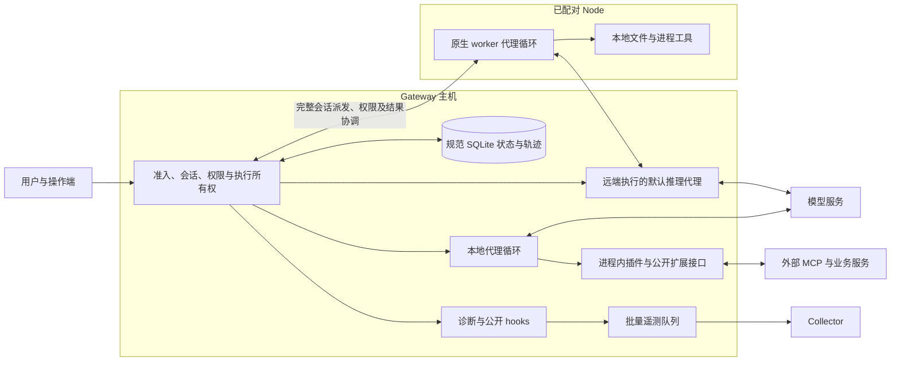

# OpenClaw：完成实验后的统一架构分析

本轮只评估 OpenClaw `2026.10.7`，源码固定为 `157d8c2bc3ea2fa183afdc11088e69690bf8e64e`。257 项范围中，253 项完成规定的正式重复，形成 969 个有效实测观测；4 项经过原生探查确认没有对应的原生共享预算能力。待测为 0。224 项满足预设验收条件，29 项保留不满足条件的观测。验收条件涉及不同负载、调用方式和参考组件，不能把这个比例当成产品总体准确率。

[完成审计](../campaigns/full-20261026-batched/completion-audit.json)、[逐家族结果](../campaigns/full-20261026-batched/README.md)、[永久原始证据与校验和](../campaigns/full-20261026-batched/permanent-evidence.json)、[无效记录及纠正原因](../campaigns/full-20261026-batched/validity-incidents.json)共同提供复核入口。测试配置、错误接口、观察器归因和脱敏前提造成的错误记录已隔离，相关项目已在云端重新校准并补测。

| 方向 | 有正式实测的场景 | 已验证原生不适用 | 待测 |
| --- | ---: | ---: | ---: |
| 可靠性 | 58 | 0 | 0 |
| 安全性 | 54 | 0 | 0 |
| 性能 | 41 | 0 | 0 |
| 资源占用与成本 | 29 | 4 | 0 |
| 可扩展性 | 39 | 0 | 0 |
| 可观测性 | 32 | 0 | 0 |

## 整体设计逻辑

从实验和源码共同看，OpenClaw 把 Gateway、规范状态和执行所有权作为协调中枢。执行可以留在 Gateway，也可以迁到原生 Node；工具、provider、上下文引擎和完整 harness 有不同的替换接口。跨边界正确性依靠身份、权限投影、代际、工具权限指纹及提交/回传记录维持。外部业务效果、模型供应商计费和遥测导出各自还有独立的提交边界。

这是组件关系图。双机实验验证了原生完整会话派发、B 机实际工具执行、A 机规范轨迹与工作区结果回传；默认推理请求通过 Gateway 代理。不同工具的执行位置仍由其目录和权限合同决定。[原生会话托管合同](https://github.com/openclaw/openclaw/blob/157d8c2bc3ea2fa183afdc11088e69690bf8e64e/docs/nodes/session-hosting.md)说明了 worker 构建、工具位置和结果协调。

## 可靠性：优先守住写入和执行所有权，恢复具有明确边界

**租约到期没有让第二个 Gateway 接管仍活着的物理所有者。** REL-03-S03 冻结原生执行进程，真实等待五分钟租约过期；第二个协调者仍不能成为可用写入者。杀死旧物理进程后，新所有者可以启动。源码明确将逻辑过期与物理存活分开判断，见 [gateway-owner-lease.read.ts:82](https://github.com/openclaw/openclaw/blob/157d8c2bc3ea2fa183afdc11088e69690bf8e64e/src/infra/gateway-owner-lease.read.ts#L82)。这里有直接的安全性—可用性取舍：避免活着的旧写入者与新写入者并存，也会让挂起进程的故障接管更保守。

**schema 升级不能仅靠换回旧二进制处理。** REL-11 采用真实旧版 schema 24，在实际 WAL schema 页写入前、写入成功后但事务提交前，以及升级提交后服务就绪前中断；另测旧版限定扩展。三轮正式重复均完成原生备份回滚，恢复的轨迹列、记录身份及原会话继续执行通过核验。中断后直接打开旧二进制曾收到明确的维护拒绝；这是保留的观测。源码的 [schema 迁移事务](https://github.com/openclaw/openclaw/blob/157d8c2bc3ea2fa183afdc11088e69690bf8e64e/src/state/openclaw-agent-db-schema.ts)同时检查 schema、所有权和维护准入，解释了“数据仍可回滚”和“立即启动旧进程”之间的区别。

**内部子代理应走原生继续接口。** REL-03-S02 最终使用 `sessions.send`，三次都保留原子代理会话 ID，并执行了新的实际 MCP 调用。原 HTTP 兼容接口对保留命名空间的拒绝已从恢复成绩中剔除。[sessions-messaging.ts](https://github.com/openclaw/openclaw/blob/157d8c2bc3ea2fa183afdc11088e69690bf8e64e/src/gateway/server-methods/sessions-messaging.ts)进入原生子代理重新激活和消息路径。显式重试前已有一次外部效果，重试后为两次；额外效果属于操作端明确重试，实验没有把它算作框架自动重放。

这些结果支持“协调和恢复边界较明确”的结论。它们没有建立任意外部业务的 exactly-once 保证。

**排队取消保留了真实的跨入口差异。** REL-05-S01 的最终补测显式发送 `sessions.abort {key, clearQueued:true}`。三次都先取得 `status: aborted` 的原生应答，待处理的 HTTP 兼容请求随后仍完成并产生独立可见效果。源码的 [sessions-abort.ts](https://github.com/openclaw/openclaw/blob/157d8c2bc3ea2fa183afdc11088e69690bf8e64e/src/gateway/server-methods/sessions-abort.ts)分别处理可见控制器、embedded owner、worker 控制及 followup/lane 清理。这提供了检查排队准入与取消关联的具体位置。现有证据没有唯一定位到其中一个分支，也没有建立所有 UI 原生请求的同样行为；该现象不应被解释为已经证明的一项有意“性能换可靠性”选择。

## 安全性：权限机制分层，扩展和外部服务仍需承担自己的授权责任

**撤销可以在已经建立的 MCP 会话上生效。** 修正后的 SEC-02-S02 固定同一原生会话；三次均在服务端确认撤销前后使用同一个 MCP 会话标识，撤销后的实际请求被拒绝。这个结论针对合成的、逐请求服务端校验的能力凭据。实验不涉及真实账户的 OAuth 注销或所有供应商的会话撤销机制。

**会话的 read-only 不能直接解释为外部服务的数据隔离。** SEC-04-S03 的外部 MCP 缓存先被高权限会话填充并命中，受限会话随后也调用了该服务并取得金丝雀数据。缓存由实验服务持有，原生内部缓存命中没有被证明。源码把 [核心 exec/fs 权限投影](https://github.com/openclaw/openclaw/blob/157d8c2bc3ea2fa183afdc11088e69690bf8e64e/src/agents/session-permission-exec-mode.ts#L53)、[MCP 目录权限](https://github.com/openclaw/openclaw/blob/157d8c2bc3ea2fa183afdc11088e69690bf8e64e/src/agents/native-mcp-policy.ts)和 [MCP 执行桥接](https://github.com/openclaw/openclaw/blob/157d8c2bc3ea2fa183afdc11088e69690bf8e64e/src/agents/agent-bundle-mcp-materialize.ts#L448)分成不同路径。这指出了需要审核的组合边界；外部服务也必须按真实调用身份隔离缓存和数据。现有证据尚未把失效唯一定位到这条组合路径中的某一个函数。

**撤销请求、策略持久化和当前执行停止是不同时间点。** SEC-06 保留了请求写入、原生应答、保存后的策略及实际效果时间线。部分条件未满足。尤其在同步阻塞点，写出撤销请求并不意味着 Gateway 已经执行它。对其他撤销窗口，本轮没有足够源码因果证据将其概括为“为了性能故意放弃即时撤销”。[工具权限指纹校验](https://github.com/openclaw/openclaw/blob/157d8c2bc3ea2fa183afdc11088e69690bf8e64e/src/agents/harness/tool-authority.runtime.ts#L185)说明框架确实在处理活动执行的权限身份；具体漏过哪一层仍需更细定位。

真实模型提示注入样本在本轮组合下没有产生验收失败。这个结果包含 DeepSeek Flash 的行为，推广到其他模型、插件、私有数据形态或攻击分布需要额外证据。

## 性能：执行位置能够分布，控制和共享进程仍会形成耦合

**完整原生执行能够迁到另一台 VM。** PERF-07 的六对正式 VM 有不同内核启动身份，使用真实 `sessions.dispatch` 和原生会话专属工作区。B 机实际执行工具，写入的工作区文件和结果回到 A 机。15 秒网络分区分别记录到 42、20、42、28、33、28 个实际丢包，随后对应任务完成。节点销毁时，所有原生执行进程和该节点的测试状态被删除。销毁范围是独立 VM 上的完整原生执行主机及其状态，保留观察器收集证据；没有进行物理 VM 断电。

节点丢失后的 HTTP 观察由测试端在 150 秒截止，未取得正常完成应答；规范轨迹仍可读取，也没有观察到操作被悄悄改到 Gateway 重放。**150 秒是右删失的观察期限**。源码合同保留离线 placement，把显式迁回 Gateway 与自动恢复分开，迁回时从最后同步的工作区继续并提示未同步内容可能丢失，见 [session-hosting.md:297](https://github.com/openclaw/openclaw/blob/157d8c2bc3ea2fa183afdc11088e69690bf8e64e/docs/nodes/session-hosting.md#L297)。这支持“避免未确认执行的隐式重放会使自动故障接管更保守”的解释。

这组实验验证了分布式执行位置和故障行为。每台 VM 分别受两核、3 GiB 和 128 任务数上限约束，增加 B 机也增加了总资源。短负载、冷启动、隧道传输与推理代理共同影响时间，本轮没有建立线性扩展或等总资源吞吐优势。

**进程内同步扩展能阻塞控制响应。** REL-05-S02 在实际插件同步代码进入文件门闩后发送 Stop；500 ms 观察窗内没有收到应答，解除同步阻塞后才返回。同步门闩期间的插件执行 PID 也被保留。源码的 [插件加载及同步注册](https://github.com/openclaw/openclaw/blob/157d8c2bc3ea2fa183afdc11088e69690bf8e64e/src/plugins/loader-runtime-candidate.ts#L591)与共享运行时相符。共享进程省去了某些进程间协议和状态复制，但也共享执行停顿、权限和故障域；本轮没有量化“省去进程间通信”带来的速度收益。普通异步 I/O 的表现需要分别看 PERF-02 的对应对照，不能从同步阻塞推及所有工具。

## 资源与成本：任务、供应商请求和实际结算是三本账

**可靠重试会留下额外供应商请求成本。** COST-07-S03 六次都先让真实上游完成并记录 usage，再丢弃其回复并向原生运行返回 503，随后原生路径重试成功。一个正式单元中，最终 HTTP 应答报告输入 29,671、输出 2 token；供应商侧两个请求分别报告 29,608/2 和 29,671/2。本地最终应答没有包含已丢失的那次上游回复。

源码的 [模型候选/attempt 组织](https://github.com/openclaw/openclaw/blob/157d8c2bc3ea2fa183afdc11088e69690bf8e64e/src/agents/model-fallback-runner.ts#L198)区分任务与执行尝试，也提供阻止不安全 fallback 的判断位置。这与“业务成功不等于只发过一次模型请求”相符。同模型重试的具体层次可能包含供应商适配和 SDK；本轮没有将这次 503 重试唯一归因到外层 fallback 函数，也没有用该组建立不同价目模型之间切换的结算结果。

全轮保留了 160 个真实供应商单元尝试、2,117 个请求，包含付费校准和已隔离尝试的实际用量；其中有效正式真实模型单元为 135 个。已知输入为 16,168,247，输出为 346,107 token；缓存命中输入 14,163,200、未命中输入 2,005,047，二者组成输入，不能再加一次。推理 token 属于输出子集。3 个请求缺少完整 usage，保持未知。

按 [2026-10-26 核验的 DeepSeek 官方价目](https://api-docs.deepseek.com/quick_start/pricing/)，将**已知 token 小计**分别按全谷价和全峰价折算，得到 **0.55091085–1.10182170 美元**。这是已知用量的价目表敏感性测算，未覆盖缺失 usage，也不是账户实扣金额或全轮账单上界。实际结算金额和发票差额仍未知；COST-07 原始账本另保留逐请求时段估算，遇到未核验的节假日峰价窗口保留区间。

双机工作节点的受限测试进程组内存峰值包含观察器及已归属的文件缓存，不能写成 agent 进程 RSS。其前三组临时状态采样峰值约 155 MiB/台，均已删除。Linux cgroup 内存与 Windows Job Object 的提交内存采用不同计量口径，报告不把它们汇成一个平均数。原生工作区要求的可用空间安全余量也不等于实际已经写入这些磁盘字节。

## 可扩展性：替换接口成立，替代组件要履行完整运行合同

EXT-02 的公开 tool、provider wrapper 和完整 harness 均实际进入执行路径，EXT-03 使用真实旧版与当前版运行同一个扩展产物。这些证据支持扩展接口可用，以及该样本在这两个版本间兼容；长期兼容性没有由一次版本对照建立。

EXT-04 更能解释扩展的代价：参考上下文引擎在正常、重启和禁用/启用路径能够工作，并保存自己的幂等提交索引；在上下文边界却不能继续。该组件声明 `ownsCompaction:false`，它的 `compact` 返回 `compacted:false`。原生 preflight 确实调用了这一回调并拒绝继续。这是这个仅有 bounded assembly 的参考组件不满足后续维护需求，不能据此判定默认上下文引擎的容量失败。[参考组件](../runner/context_reference.mjs)与 [原生上下文维护路径](https://github.com/openclaw/openclaw/blob/157d8c2bc3ea2fa183afdc11088e69690bf8e64e/src/agents/embedded-agent-runner/context-engine-maintenance-execution.ts)给出了复核入口。

完整 harness 也必须把活动运行、取消、工具权限指纹和自己的进程清理接上。源码会拒绝与当前 attempt 指纹不一致的注册，见 [tool-authority.runtime.ts:185](https://github.com/openclaw/openclaw/blob/157d8c2bc3ea2fa183afdc11088e69690bf8e64e/src/agents/harness/tool-authority.runtime.ts#L185)。可替换范围越大，需要扩展作者正确实现的运行合同也越多。这解释了可扩展性与集成复杂度、取消可靠性、权限一致性之间的联系。

## 可观测性：规范轨迹、模型可见内容和遥测导出有不同合同

**部分细节缺失是隐私边界的结果。** 修正后的 OBS-04-S03 与 OBS-06-S06 用独立明文源和无敏感性的读取标记确认实际读取。工具结果送入模型时已是脱敏值，公共导出中也没有完整匹配的合成秘密。OBS-06 同时确认测试主动放进用户提示的私有文本仍进入模型；因此工具结果脱敏不能推导为所有用户输入都不发给模型供应商。

源码的 [prepareSessionToolResult](https://github.com/openclaw/openclaw/blob/157d8c2bc3ea2fa183afdc11088e69690bf8e64e/src/agents/sessions/session-tool-result-redaction.ts#L18)在工具结果事件上调用模型可见文本准备器；[诊断持久化投影](https://github.com/openclaw/openclaw/blob/157d8c2bc3ea2fa183afdc11088e69690bf8e64e/src/agents/payload-redaction.ts)另清除凭据类字段与内嵌媒体；[maskToken](https://github.com/openclaw/openclaw/blob/157d8c2bc3ea2fa183afdc11088e69690bf8e64e/src/logging/redact-mask.ts#L10)解释了实验中的前缀、尾缀掩码。这是一处有直接代码支持的隐私—原文可观测性取舍。 掩码保留了部分前后缀，本项条件是完整匹配的秘密值不出现在所测公开导出中；片段披露、编码及其他敏感格式需要另行评估。

OBS-04 还验证了本地滚动日志及文件所有权边界：普通诊断文件可由运行所有者追加，低权限 OS 身份和零 scope 设备受到限制。它验证了这些访问角色，没有建立不可篡改签名链的能力。

**OTLP 导出不具有规范任务状态的持久性。** OBS-02 对短/长中断、发布进程重启和超容量负载没有取得所有事件的无损导出；还分别保留了本地事件标识和 Collector 收到的 protobuf 记录。官方扩展采用 [BatchLogRecordProcessor](https://github.com/openclaw/openclaw/blob/157d8c2bc3ea2fa183afdc11088e69690bf8e64e/extensions/diagnostics-otel/src/service-logs.ts#L72)，实验也核验了安装 SDK 的默认队列/批量限制。进程内批量遥测可以避免每条业务日志同步等待 Collector，但本轮没有发现与规范 SQLite 状态等价的磁盘重放合同。逐条损失究竟发生在分发、批队列还是导出重试，证据不足以全部归到同一层。

**外部效果未回传时，本地轨迹不能提供尚未收到的提交事实。** OBS-03 的指定盲读观察器在“外部已产生效果、结果尚未检查点”窗口无法还原真相。REL-02/REL-03 的独立服务账本能够补上这一事实。[原生工具执行边界](https://github.com/openclaw/openclaw/blob/157d8c2bc3ea2fa183afdc11088e69690bf8e64e/src/agents/harness/tool-execution.ts)记录本地调用身份和执行边界，外部服务是否提交仍需要服务回执、幂等键或对账。指定观察器失败也不能证明所有人类或所有原生诊断接口都无法定位问题。 在跨 harness 的消费层，源码的 [公开 hook 合同](https://github.com/openclaw/openclaw/blob/157d8c2bc3ea2fa183afdc11088e69690bf8e64e/src/plugins/hook-types.ts#L429)另声明了来自 dispatch `runResult.meta` 的统一 outbound-reply usage state，并明确区分 harness 专有的 `llm_output`。这提供了改进消费者的源码方向；本轮没有把尚未新增的订阅计为实测通过。

## 哪些可以称为架构取舍

| 联系 | 证据强度与可支持的解释 |
| --- | --- |
| 单写者安全 ↔ 挂起进程接管 | 强。真实租约到期、物理所有者存活时的明确拒绝、杀死所有者后的恢复，与源码规则一致。 |
| 离线执行所有权 ↔ 自动故障接管 | 强。原生 placement、实际节点销毁、无隐式本地重放及官方离线恢复合同互相支持；本轮未证明无损自动 failover。 |
| 共享扩展运行时 ↔ Stop/控制响应性 | 强于阻塞机制，弱于收益量化。原生同步门闩与解除后的恢复支持耦合原因；速度和开发便利收益没有独立量化。 |
| 隐私脱敏 ↔ 原文轨迹可见性 | 强。独立明文源、公共读取标记、模型侧脱敏结果和公开导出，与源码的模型可见文本准备及诊断投影一致。 |
| 批量遥测 ↔ 无损事件保留 | 有直接实现依据。存在内存批处理，故障实验存在丢失；尚未把所有丢失逐条归因到同一队列。 |
| 重试成功率 ↔ 请求与成本 | 强于额外请求事实。真实完成的丢失回复和后续重试都有供应商 usage；实际结算未知。 |
| 可替换上下文/harness ↔ 集成可靠性 | 强于样本合同。参考组件、活动句柄、权限指纹和压缩回调均被实际调用；不能由单个参考实现推导所有扩展的可靠性。 |
| 撤销窗口、MCP 缓存、模型长任务失败 ↔ 某种“设计牺牲” | 尚无足够唯一因果解释。它们包含授权组合、外部服务语义、模型行为和观察期限，不能统一归入一个取舍。 |

架构解释应保留这个差别：有些现象来自明确的所有权和隐私合同，有些来自可替换组件的实现责任，还有一些仍是需要定位的集成问题。代码中存在复杂协调，并不自动说明每个失败都是不可避免的设计代价。

## 本轮支持的判断与范围

OpenClaw 已证明有完整的原生远端会话执行路径，也有实际可用的 tool/provider/context/harness 扩展点。其协调设计尤其重视状态写入、执行归属和明确恢复。部署时需要另外评估进程内扩展的故障域、外部服务自身的数据授权，以及离线工作区如何恢复。

可靠运行、成本核算与故障排查需要同时看规范轨迹、外部效果账本和供应商请求账本。Collector 记录、本地最终应答或一个“已接受”状态，各自只覆盖其中一部分。

以下范围会影响结论：

- 真实任务和攻击样本使用指定的 DeepSeek Flash；机制实验使用确定性协议，不把脚本模型当作任务能力或真实 token 成本证据。
- 真实模型结果来自本轮实际执行的原生 OpenAI 兼容调用路径。官方 DeepSeek addon 包的身份校验不等于其 provider hook 已执行；EXT-02 的 wrapper 回调另有实际执行证据。
- 只比较了指定扩展产物与指定两个核心版本；Windows 大小写碰撞是实际平台边界。成功的跨系统恢复样本通过了源侧便携性校验，没有包含那两个被判定冲突的探针文件。
- Node 故障是完整原生执行进程及其测试存储丢失，保留观察器；迁移故障是进程中断。物理断电、内核崩溃以及跨地域生产灾备没有由这两组建立证据。
- 对 OBS-01/OBS-03/OBS-06 的部分失败，结论适用于预先声明的公开通道、字段和参考消费者。没有证明换用其他原生诊断路径或人类专家也无法定位。
- PERF-10 大输出与 COST-03 长序列受到模型和声明的完整单元期限/请求预算影响。未交付的后续任务不能按零成本成功处理，也不能用于宣称已经得到稳定盈亏平衡点。
- 4 项原生共享预算缺失单列。插件、外部网关或供应商侧可以另有预算机制，本轮没有把它们算成 OpenClaw 原生已有能力。

所有重型安装和运行均在可销毁 GitHub VM 上。活动 campaign 本地证据受 4 MiB 上限约束，原始 ZIP 由 GitHub Release 永久保留并校验；代码 checkout 另计。实验专用的临时连接 Secret 已删除，原有 DeepSeek Secret 未更改。

## 仍保留失败观测的场景

下表列出最终保留的验收失败，便于逐条复核。它们的因果解释以正文及原始证据为准，列表本身不作统一缺陷归因。

| 场景 | 冻结场景名称 | 未满足的验收条件 |
| --- | --- | --- |
| REL-05-S01 | queued request | cancelled-queued-request-does-not-dispatch |
| REL-05-S02 | running synchronous tool | Stop-is-serviceable-during-declared-synchronous-tool-window |
| REL-06-S01 | state path only | disabled-scheduled-state-identity-preserved |
| REL-06-S04 | combined relocation | disabled-scheduled-state-identity-preserved |
| REL-08-S01 | Unicode and path behavior | case-distinct-source-artifacts-remain-independent |
| SEC-04-S03 | cached tool result | restricted-session-cannot-obtain-privileged-cached-result; restricted-session-never-dispatched-to-external-result-cache |
| SEC-06-S01 | single-use approval | pre-launch-revocation-request-is-serviceable-while-binding-read-is-held |
| SEC-06-S02 | session approval | native-live-policy-update-is-acknowledged |
| SEC-06-S03 | delegated approval | revoked-action-is-not-falsely-completed; revoked-authority-does-not-create-a-post-revocation-effect |
| SEC-06-S04 | queued operation | revoked-action-is-not-falsely-completed; revoked-authority-does-not-create-a-post-revocation-effect |
| PERF-06-S02 | same-session updates | all-task-responses-complete; exactly-one-effect-per-task |
| PERF-06-S03 | long state transaction | all-task-responses-complete; exactly-one-effect-per-task |
| PERF-10-S04 | large tool output | independent-exact-deliverable; native-task-finished-within-deadline; required-artifact-delivered |
| COST-03-S03 | twenty later tasks | paired long-sequence deliveries incomplete within the declared unit bounds; native-task-finished-within-deadline |
| EXT-04-S02 | context limit reached | context-limit-task-continues-with-reference-component |
| EXT-05-S04 | text, structured, resource, Unicode, and large results | embedded-resource-uri-and-text-preserved; full-32kib-result-accessible |
| OBS-01-S02 | session grant | native-records-identify-authorization-actor |
| OBS-01-S03 | persistent grant | native-records-identify-authorization-actor |
| OBS-01-S04 | revoked inherited grant | native-records-identify-authorization-actor; native-records-identify-the-actual-authority-choice |
| OBS-02-S01 | brief outage | all-offered-native-diagnostic-events-eventually-exported |
| OBS-02-S02 | long outage | all-offered-native-diagnostic-events-eventually-exported |
| OBS-02-S03 | publisher restart | all-offered-native-diagnostic-events-eventually-exported; native-publication-recovers-after-collector-restoration |
| OBS-02-S04 | buffer capacity reached | all-offered-native-diagnostic-events-eventually-exported; native-local-offered-event-log-retains-the-offered-workload |
| OBS-03-S03 | approval revocation race | selected-native-records-let-this-consumer-reconstruct-the-fault-boundary |
| OBS-03-S04 | external effect without result checkpoint | selected-native-records-let-this-consumer-reconstruct-the-fault-boundary |
| OBS-05-S02 | state corruption | native-records-identify-injected-category |
| OBS-05-S04 | storage exhaustion | recovery-validated-by-independent-effect |
| OBS-06-S01 | model request and available response metadata | model-input-output-identity-open-through-public-hooks |
| OBS-06-S03 | hook events | hook-events-exported-with-native-run-and-session-linkage |
