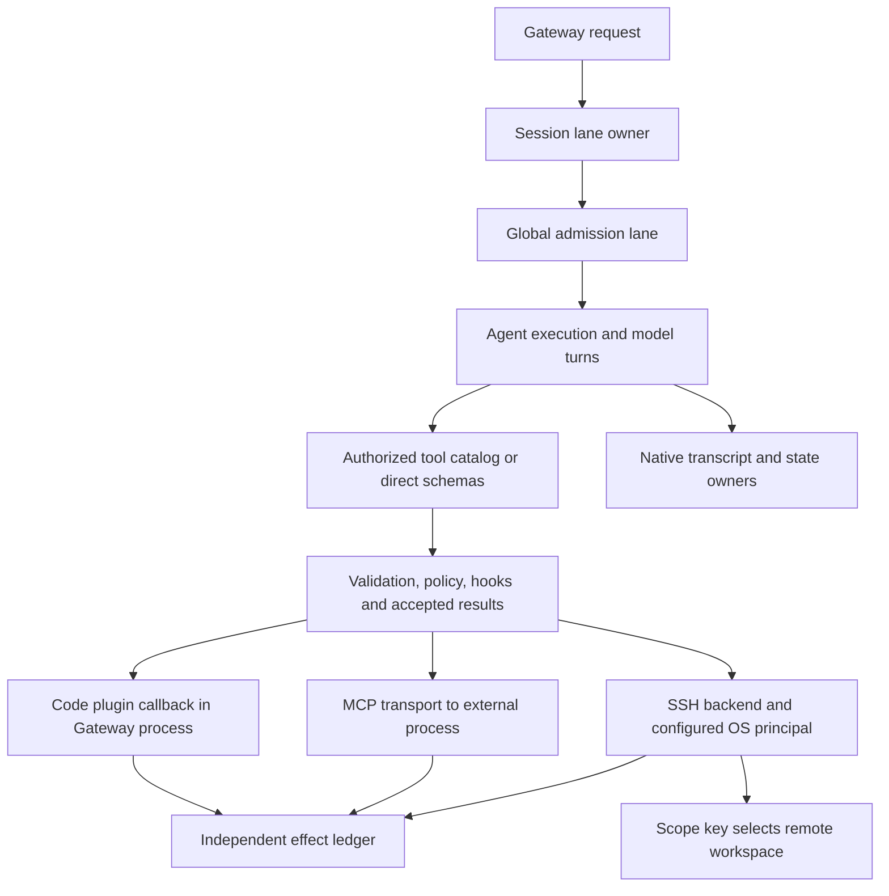

# Source-driven architecture investigations

The unit of work is a surprising observation and its explanation, not a count of passing test groups. The [investigation registry](design/source-investigations.json) binds observations, alternative explanations, source owners, counterevidence and targeted followups to the exact campaign commit. Source hashes are checked before excerpts enter an evidence artifact. The previous three pilots are starting evidence, not the completion criterion.

The [completed source review](evidence/source-followup-20261026/README.md) contains the discriminating results, corrected attributions, joint six-axis interpretation and explicitly unresolved hypotheses. The registry below preserves predictions made before that execution rather than silently rewriting them to fit the results.

## Implementation ownership map

The concrete seams are `server-lanes.ts`, `run-orchestrator.ts`, `run/lane-controller.ts`, `command-queue.ts`, `tool-search-runtime.ts`, plugin registrars/`PluginInstance`, and the SSH/remote-shell owners. The registry contains immutable upstream paths, line ranges, symbols and full-module hashes; this diagram alone is not source evidence or proof of thread placement for every component.

## F01: concurrency without consistent short-task goodput gain

The retained current-release events show four provider requests for every completed task. Our `planned_tool_call` chose search, describe, invoke and final response. In the release source, `ToolSearchCatalogRuntime.call` calls `findEntry`, whose default matching mode accepts an exact ID or an unambiguous name. There is no mandatory dependency on a previous search or describe call. Therefore four model turns are a fixture strategy, not an architectural lower bound.

The queue sources separately bind `agents.defaults.maxConcurrent` to the main lane and admit asynchronous tasks until the lane's active-count budget is reached. The embedded runner wraps global admission inside session admission. Raising this budget creates more admitted asynchronous work; it does not itself create more JavaScript execution threads. The existing overlap result proves that global admission was exercised, but does not identify the residual bottleneck.

Preregistered followups:

- SRC-01 compares conservative catalog discovery with known-name native catalog dispatch at one tool. This changes the deterministic provider's strategy, not OpenClaw implementation. It then compares 1 versus 64 eligible tools and the large-catalog native default versus explicit `tools.toolSearch: false` with the same task contract. Collect actual request counts, full wire bytes, tool-schema bytes, batch-only CPU, accepted effects and a forced excluded-tool control. Byte counts remain distinct from actual token charges.
- SRC-02 holds known-name catalog dispatch fixed, crosses concurrency 1/4 with independent tool waits of 150/1500 ms, and samples the owned Gateway main thread through the Node inspector. Batch CPU excludes startup. CPU profiles retain only bounded hot frames/stacks, module hashes and published bundle source-region hints; raw profiles are discarded. Instrumented timing and source-region hints do not certify exact source-map attribution or uninstrumented production performance.

Possible interpretations are deliberately separated. A reduction in requests after changing the fixture identifies avoidable evaluator strategy overhead. A reduction in schemas or wire bytes after changing native catalog configuration supports context-footprint effects. A larger concurrency gain with longer waiting supports an IO-overlap mechanism. A specific CPU bottleneck still needs relevant hot stacks and a targeted intervention; neither a global CPU counter nor the language name establishes it.

## F02: plugin termination and its actual trust/fault boundary

The plugin registrar retains executable factories, the loader invokes registration through `PluginInstance`, and that instance owns invocation/lifecycle scopes. `PluginInstance.invoke` calls the supplied function within its context; tool execution invokes the executable callback and propagates ordinary errors through wrappers. These logical scopes are not OS processes. The source's design statement prefers code plugins when deeper runtime hooks/providers/channels/tools are needed, while bundle/MCP-style integrations expose narrower external contracts.

SRC-03 contrasts a thrown JavaScript error with process exit, observes the actual HTTP-listener PID and callback PID/thread, and checks whether an independent request still works without changing owner PID. Both routes read the same explicitly accessible synthetic canary and report UID. This tests two separate claims: an exception is not equivalent to terminating the host process, and a separate PID is not automatically a different filesystem principal. If a negative outcome occurs, retain it as counterevidence rather than redefining it as an invalid measurement.

Successful deeper integration is a documented design objective, not automatically a measured net benefit. This investigation can establish the concrete shared termination domain and exception boundary. It cannot conclude that every plugin failure kills the Gateway, that process separation alone explains latency, or that the chosen architecture is globally optimal. Hook coverage, public-interface effort and real extension workloads remain additional evidence for the benefit side.

## F03: workspace scope versus OS authority

`resolveSandboxScopeKey` chooses session/agent/workspace-qualified identity; `resolveRemoteShellRuntimePaths` turns that key into remote paths. The SSH owner uses configured host/user/key, and the remote command builder selects a working directory before running the shell command. Those are different responsibilities from assigning a distinct remote OS principal or enforcing a filesystem jail.

SRC-04 first verifies relative-path sharing/separation using the same native backend, then asks the second session to read the exact owned synthetic sibling path. Keep an allowed writer control and both successful and rejected read outcomes. This probes whether the observed directory separation is also an authority boundary in this deployment. It does not extrapolate to Docker or claim that documented SSH scope promised hostile-tenant isolation.

## Closing a finding

Record the triggering observation, exact source path/call chain/state owner, hypothesis, competing explanations, smallest discriminating test, result, and six-dimensional benefit/cost/unknowns. A supported design intention comes from versioned design records; a measured tradeoff needs both benefit and cost evidence. A structural constraint can be established without proving that the constraint was worth its cost.

The shared registry preserves the pre-execution hypotheses. Completed evidence and the reviewed explanation live in a separate dossier, so later results cannot silently rewrite the original prediction. Missing measurements and counterexamples stay visible. A completed harness run is not an automatic product pass, and a negative security/task outcome is not discarded merely to make CI green.

All new runtime/dependency work remains on disposable hosted machines. Runtime state stays in the bounded tmpfs; the source collector retains at most 200 KiB of excerpts and hashes, and the artifact budget remains 2 MiB. Do not clone another source tree or install another runtime locally for an investigation.
